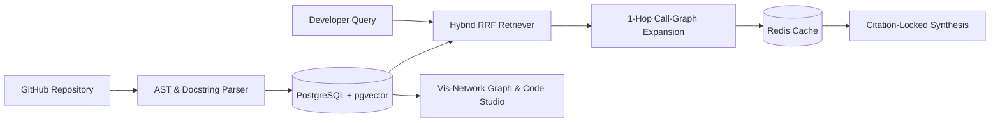

# CodeGraph AI Engine

**AST-Driven Repository Intelligence, Hybrid `pgvector` Search & Citation-Locked GraphRAG**

CodeGraph AI parses GitHub repositories into Abstract Syntax Tree (AST) symbol graphs, indexes semantic embeddings alongside documentation in PostgreSQL (`pgvector`), and answers architectural questions with strict `[file_path:start-end]` source citations.

## System Architecture



## Engineering Highlights

- **AST Call-Graph & Docstring Ingestion:** Extracts functions, classes, outgoing call edges, module docstrings, and `README` sections with exact line boundaries (`2,116` nodes across `83` files indexed on `pallets/click`).
- **Path-Weighted Reciprocal Rank Fusion (RRF):** Fuses `pgvector` cosine similarity with exact symbol/token scoring (`k=60`) and structural path priors (`src/` boosted over `tests/` and `examples/`).
- **1-Hop GraphRAG Context Expansion:** Resolves outgoing call edges on top-ranked AST nodes to supply cross-file callee signatures to the synthesis layer.
- **Sub-Millisecond Query Caching:** Hashes normalized repository queries in Redis with automatic graceful fallback.
- **Interactive Graph Studio:** Real-time force-directed Vis-Network dependency explorer paired with expandable source-code citation cards.

## Retrieval Benchmark (`pallets/click`)

| Retrieval Strategy | Recall@5 | Mean Reciprocal Rank (MRR) |
| :--- | :---: | :---: |
| Vector-Only Baseline (`pgvector` cosine) | `100%` | `0.580` |
| **CodeGraph Hybrid RRF + Path Priors** | **`100%`** | **`0.900` (+55.2%)** |

## Quickstart

```bash
docker compose up -d
python3 -m venv .venv && source .venv/bin/activate
pip install -r backend/requirements.txt
uvicorn app.main:app --app-dir backend --port 8000
```
